# Fotoğraf Portfolyo CMS

[English](README.md) | **Türkçe**

Fotoğrafçılar için çok dilli portfolyo sitesi ve yönetim paneli. Saf PHP ile yazıldı, veritabanı olarak SQLite kullanır (isteğe bağlı MySQL). Derleme adımı ya da çatı yok: tek klasörü sunucunuza kopyalayıp `/admin/` adresini açmanız yeterli.

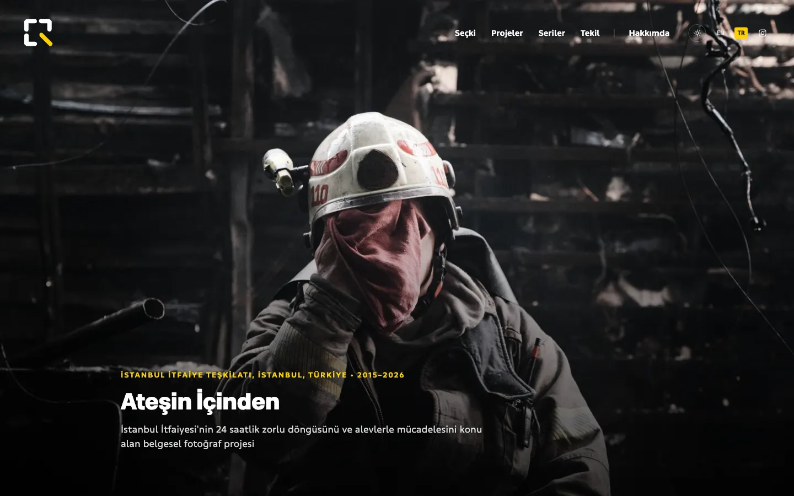

> Tüm ekran görüntüleri bu CMS ile kurulmuş gerçek bir siteden alındı: [enesreyhan.com](https://www.enesreyhan.com). İçlerindeki fotoğraflar © Enes Reyhan'a aittir ve MIT lisansının **kapsamında değildir**.

---

## İçindekiler

- [Web sitesi](#web-sitesi)
- [Yönetim paneli](#yönetim-paneli)
- [Özellikler bir bakışta](#özellikler-bir-bakışta)
- [Performans](#performans)
- [Gereksinimler](#gereksinimler)
- [Kurulum](#kurulum)
- [İlk ayarlar](#i̇lk-ayarlar)
- [Klasör yapısı](#klasör-yapısı)
- [Güvenlik notları](#güvenlik-notları)
- [Lisans](#lisans)

---

## Web sitesi

### Portfolyo listeleri

Her kategorinin (Projeler, Seriler, Tekil ya da sizin oluşturduğunuz herhangi biri) kendi liste sayfası olur. Ziyaretçi tam ekran bölümler arasında kaydırarak gezer; sağdaki küçük sayaç nerede olduğunu gösterir.

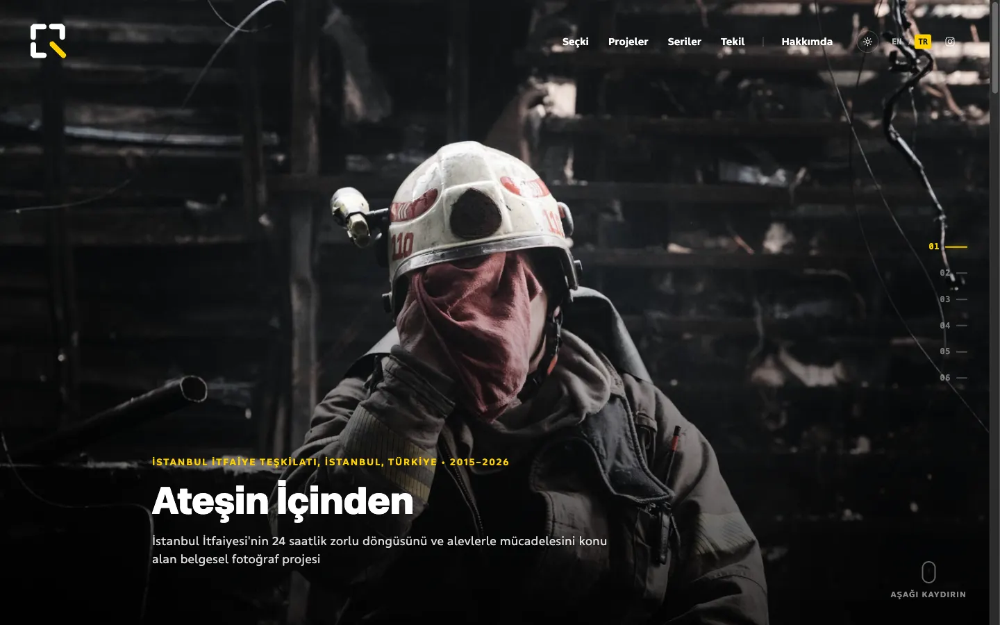

### Proje sayfası

Proje; başlığı, yeri ve yılları, giriş metni ve kapak fotoğrafıyla açılır. Ziyaretçi **sergi akışı** ile **kontak baskı** görünümü arasında, koyu ve açık zemin arasında geçiş yapabilir.

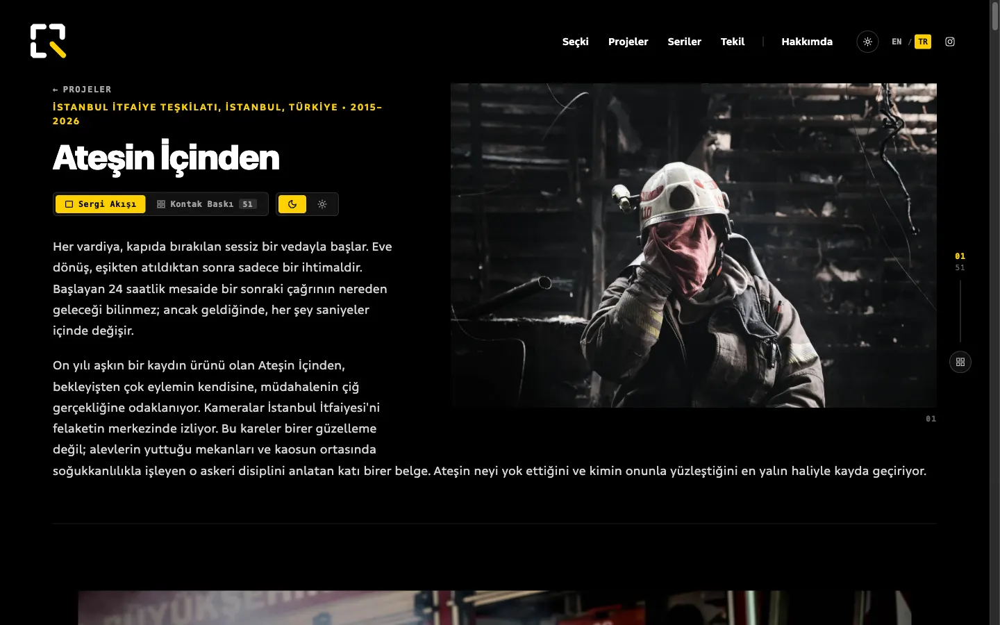

<table>
  <tr>
    <td width="50%">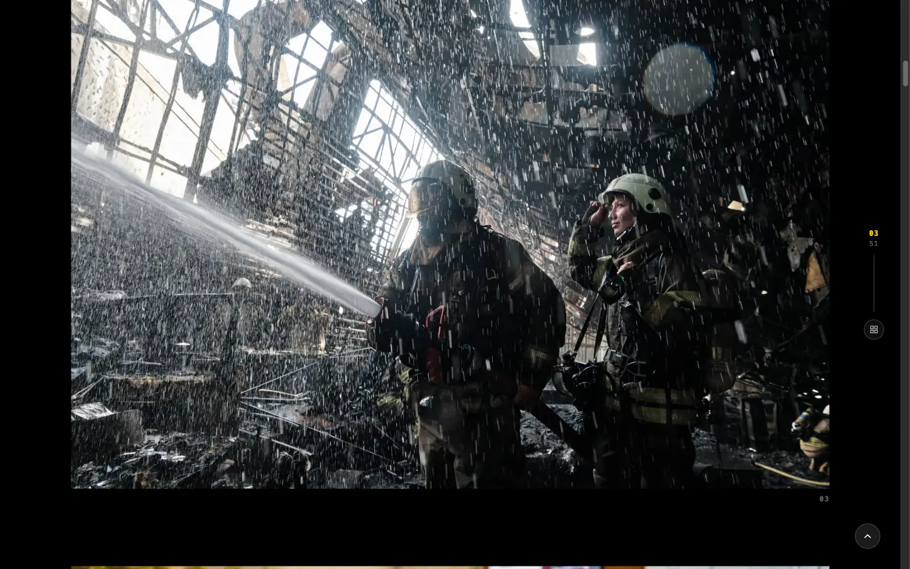</td>
    <td width="50%">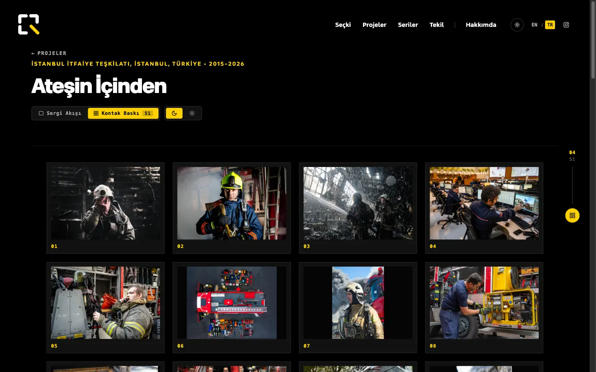</td>
  </tr>
  <tr>
    <td><b>Sergi akışı:</b> fotoğraflar tek tek; altyazılar, bölümler ve diptikler.</td>
    <td><b>Kontak baskı:</b> projenin tamamı numaralı bir ızgarada.</td>
  </tr>
</table>

### Hakkımda ve iletişim

<table>
  <tr>
    <td width="50%">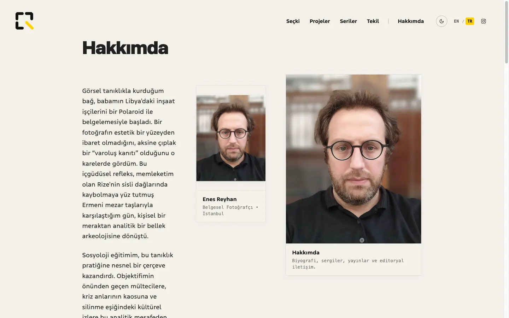</td>
    <td width="50%">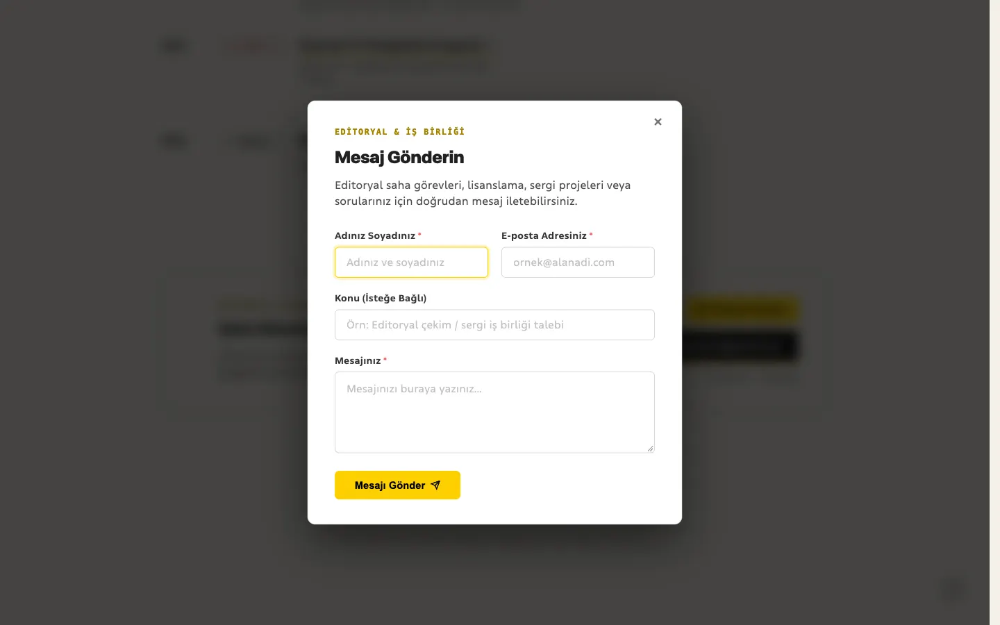</td>
  </tr>
  <tr>
    <td><b>Hakkımda:</b> biyografi, portre, sergi ve ödül kronolojisi.</td>
    <td><b>İletişim:</b> mesajları panelin gelen kutusuna (ve e-postanıza) düşen bir form.</td>
  </tr>
</table>

### Telefonda

<table>
  <tr>
    <td align="center">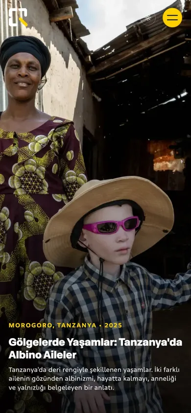</td>
    <td align="center">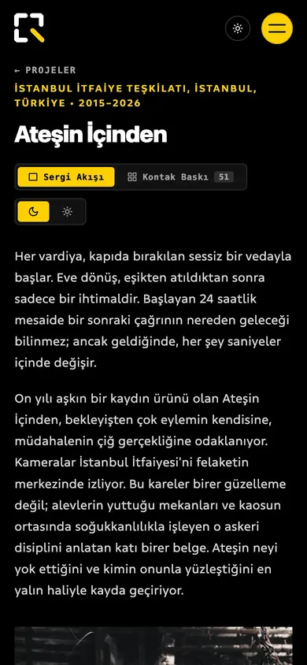</td>
  </tr>
</table>

Tüm sayfalar mobil uyumludur; küçük ekranlarda menü tam ekran bir çekmeceye dönüşür.

---

## Yönetim paneli

### Kurulum sihirbazı

`/admin/` adresini ilk açtığınızda sihirbaz önce **kurulum dilini** (18 dil), ardından ilk yönetici hesabını sorar. Yönetim paneli seçtiğiniz dilde açılır.

<table>
  <tr>
    <td align="center">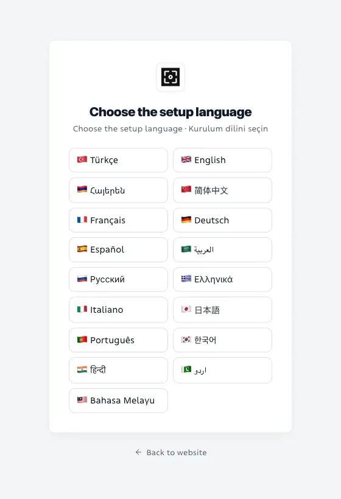</td>
    <td align="center">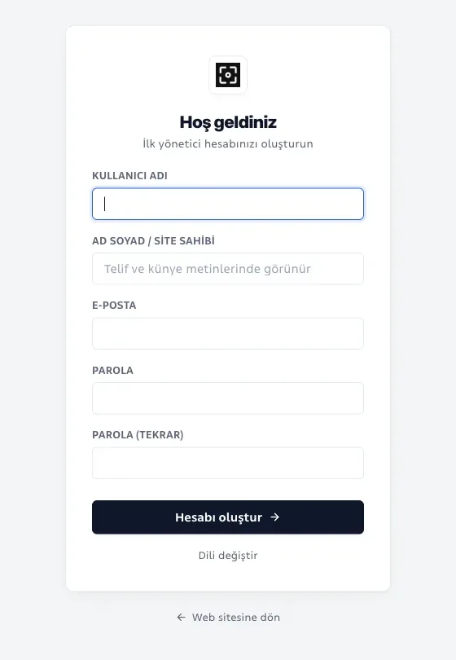</td>
  </tr>
  <tr>
    <td align="center">1. Dili seçin</td>
    <td align="center">2. Hesabınızı oluşturun</td>
  </tr>
</table>

### Genel Bakış

Panelin açılış ekranı son düzenlenen çalışmaları, ziyaretçi sayılarını (Google Analytics bağlıysa), okunmamış mesajları ve sitenin modüllerinin durumunu gösterir; dikkat gereken bir şey varsa uyarır.

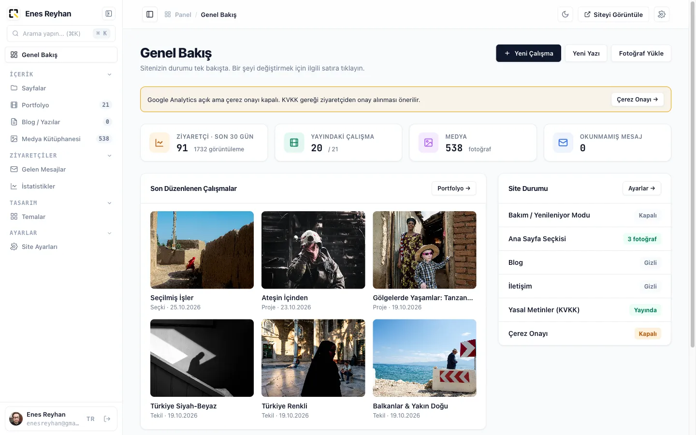

### Sayfalar

Sitenin bütün sayfaları tek listede: sabit sayfalar, liste sayfaları ve her çalışma; adresi, durumu ve menüde olup olmadığıyla. **Menü ve önizleme** sekmesinde menü sırasını sürükleyerek değiştirirsiniz.

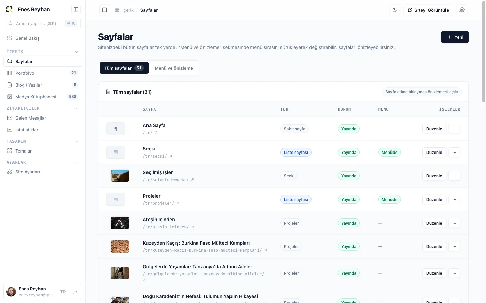

### Çalışma editörü

Her dil için başlık, kısa açıklama, konum ve yıl; zengin metin editörüyle giriş hikâyesi; odak noktasıyla kapak fotoğrafı; yan panelde adres, kategori, şifre koruması ve eski adresler.

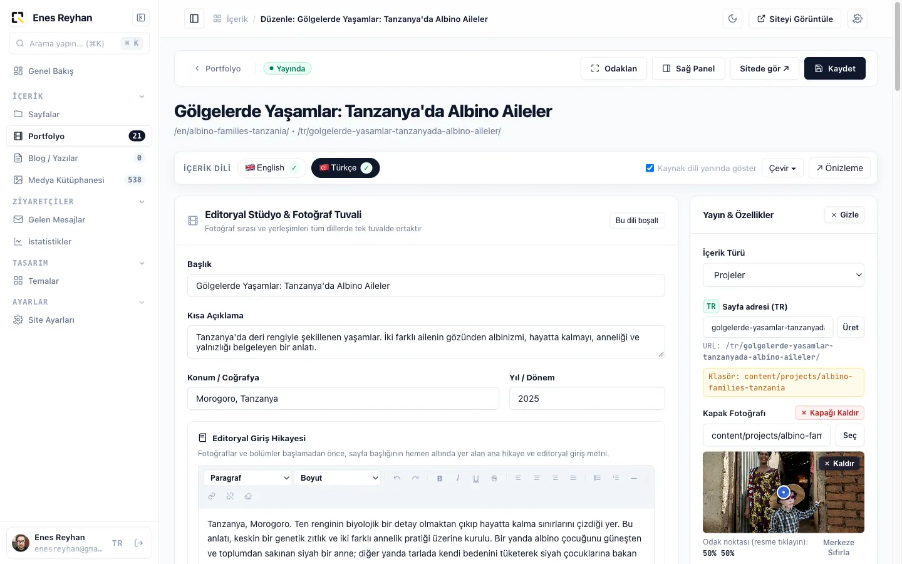

Altında **hikâye tuvali** bulunur: fotoğrafları sürükleyerek sıralayın, bölüm, metin ve alıntı blokları ekleyin, kapağı işaretleyin, iki fotoğrafı diptik yapın, her karenin altyazısını yazın.

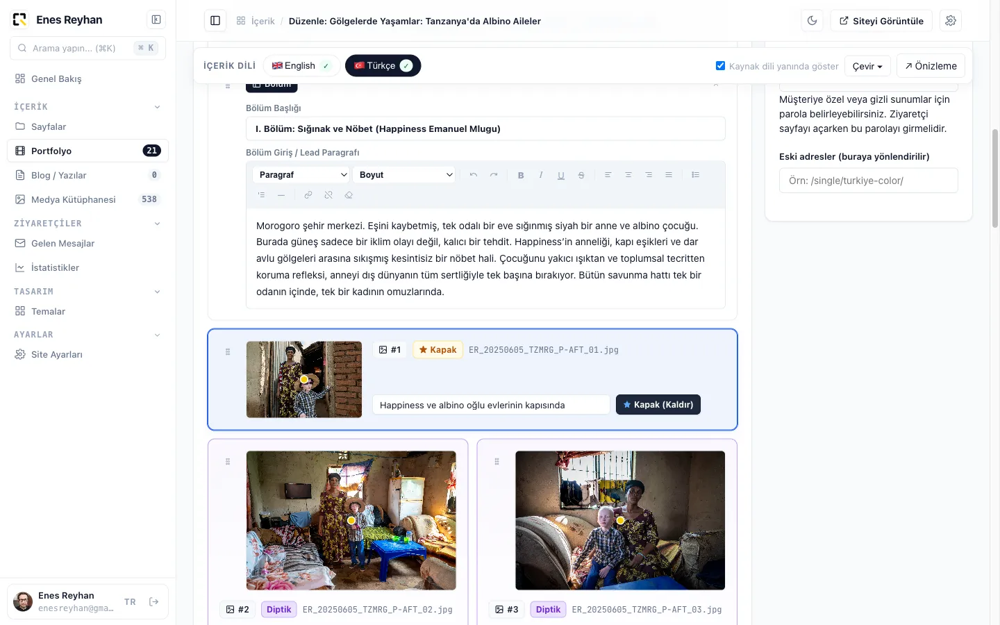

### Medya kütüphanesi

Sürükle-bırak toplu yükleme, klasörler, arama ve filtreler (ülke, şehir, yıl, kamera, diyafram, enstantane, ISO). Her yükleme otomatik olarak AVIF ve WebP'ye dönüştürülür, EXIF bilgisi okunur. Bir fotoğrafı silmeden önce kütüphane onun nerede kullanıldığını söyler.

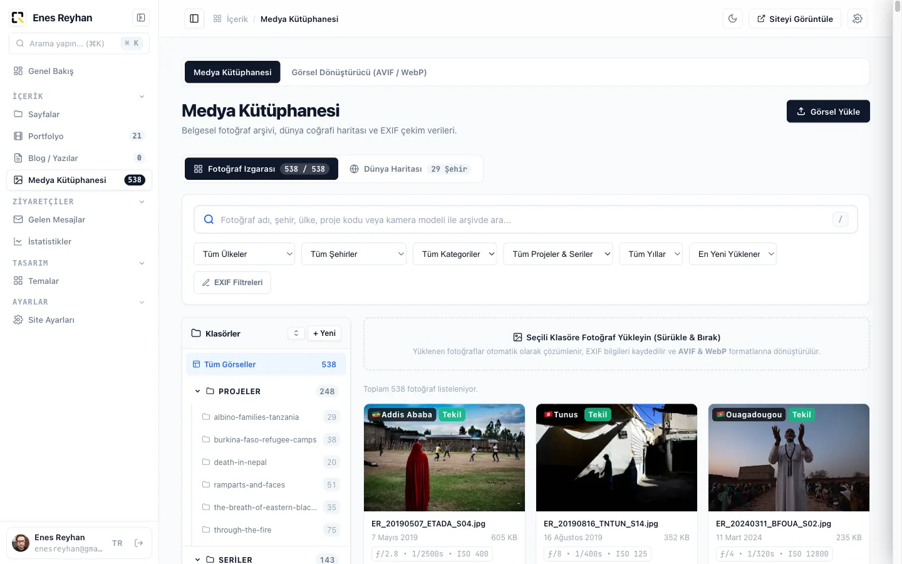

### Temalar ve canlı tasarım editörü

Kendi fotoğraflarınızla önizlenen 26 hazır tema. **Özelleştir** canlı tasarım editörünü açar: renkler, yazı tipleri, düğmeler, logo, menü, alt bilgi ve tüm sayfa türleri; masaüstü/telefon önizlemesiyle.

<table>
  <tr>
    <td width="50%">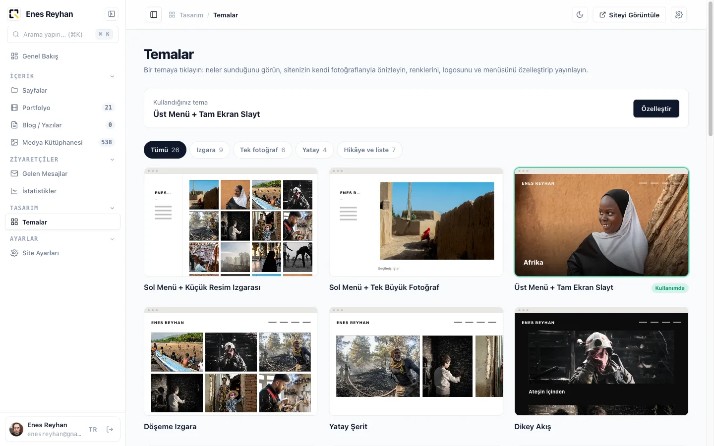</td>
    <td width="50%">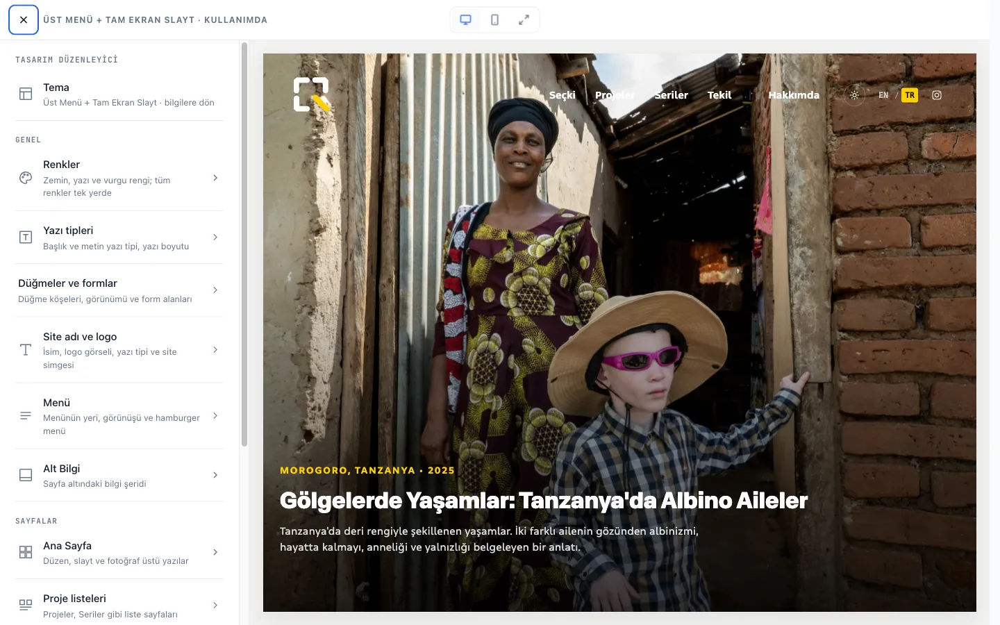</td>
  </tr>
  <tr>
    <td><b>Temalar:</b> ızgara, tek fotoğraf, yatay, hikâye ve liste düzenleri.</td>
    <td><b>Tasarım editörü:</b> değişiklikler önizlemede anında görünür.</td>
  </tr>
</table>

### Diller

18 hazır dilden birini tek tıkla ekleyin, yayınlayın ya da gizleyin; varsayılan dili ve panel dilini seçin. Çeviri tablosu ve otomatik çeviri içerikleri doldurmanıza yardım eder.

**Hazır diller:** Türkçe, İngilizce, Portekizce, Korece, Hintçe, Urduca, Malayca, Fransızca, Almanca, İspanyolca, İtalyanca, Rusça, Çince, Japonca, Arapça, Yunanca, Ermenice ve Batı Ermenicesi.

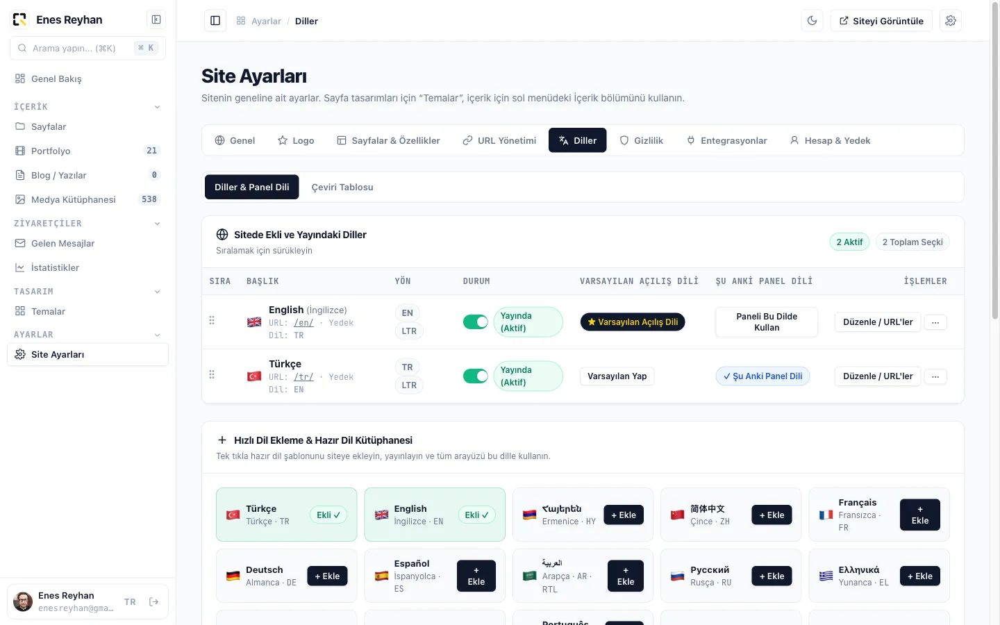

### Site ayarları

Dile göre site başlığı ve açıklaması, site sahibi, iletişim e-postası ve telefon, sosyal medya hesapları, logo ve favicon, URL yönetimi, gizlilik, entegrasyonlar, hesap ve yedek.

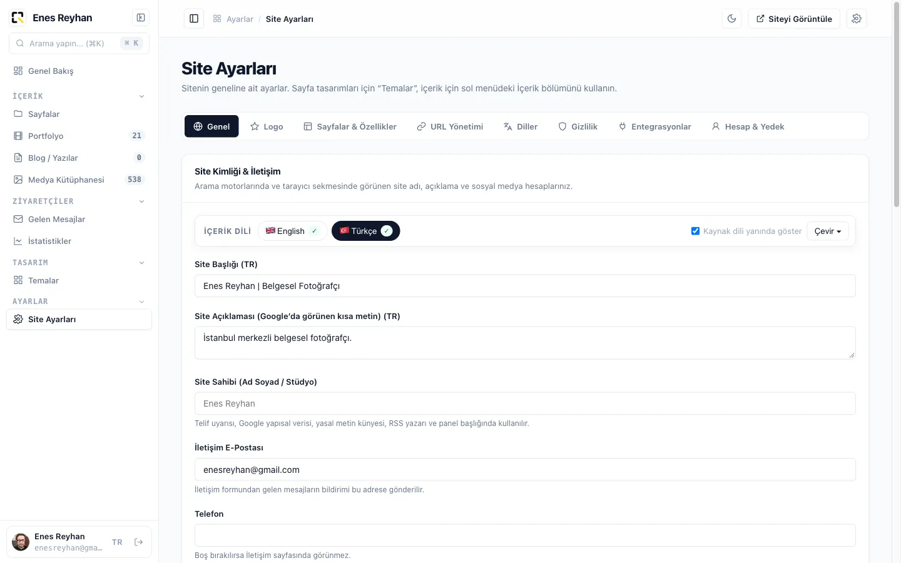

---

## Özellikler bir bakışta

| Alan | Neler var |
| --- | --- |
| **Portfolyo** | Kendi kategorileriniz, hikâye tuvali, kapak ve odak noktası, şifreli bağlantılar, taslaklar, eski adres yönlendirmeleri |
| **Ana sayfa** | Slayt seçkisi ya da tüm çalışmalar, 26 tema, canlı tasarım editörü |
| **Medya** | Toplu yükleme, klasörler, EXIF, otomatik AVIF/WebP, filtreler, "kullanımda" uyarısı |
| **Diller** | Site ve panel için 18 dil, dile göre URL'ler, çeviri tablosu, otomatik çeviri |
| **Sayfalar** | Hakkımda, İletişim (form + gelen kutusu), Blog, KVKK aydınlatma ve açık rıza metinleri |
| **SEO** | Sitemap, RSS/Atom, Schema.org, Open Graph, temiz URL'ler |
| **Diğer** | Çerez onayı, Google Analytics 4 istatistikleri, bakım modu, veritabanı yedeği indirme, giriş denemesi sınırı |

---

## Performans

[enesreyhan.com](https://www.enesreyhan.com) için [PageSpeed Insights](https://pagespeed.web.dev/analysis/https-www-enesreyhan-com/2rlyzuwtva) sonuçları (Kasım 2026):

| | Performans | Erişilebilirlik | En İyi Uygulamalar | SEO |
| --- | :---: | :---: | :---: | :---: |
| **Mobil** | 97 | 100 | 100 | 100 |
| **Masaüstü** | 100 | 100 | 100 | 100 |

---

## Gereksinimler

- PHP **8.1+** (8.2+ önerilir)
- PHP eklentileri: `pdo_sqlite`, `gd` (AVIF için GD'nin AVIF desteği), `mbstring`, `json`
- İsteğe bağlı: `curl` ve `openssl` (Google Analytics, otomatik çeviri), `exif`
- Apache/LiteSpeed (`.htaccess` ile) veya PHP'nin yerleşik sunucusu (geliştirme için)

## Kurulum

### Yerelde denemek

```bash
git clone https://github.com/enesreyhan/photo-portfolio-cms.git portfolyo
cd portfolyo
./start.sh            # ya da: php -S localhost:8000 router.php
```

Tarayıcıda `http://localhost:8000/admin/` adresini açın.

### Sunucuya kurmak (cPanel / paylaşımlı hosting)

1. [Sürümler sayfasından](https://github.com/enesreyhan/photo-portfolio-cms/releases/latest) en son sürümü (**Source code (zip)**) indirip açın.
2. Açılan klasörün **içindekileri** alan adınızın kök klasörüne (`public_html`) yükleyin.
3. PHP'nin bu klasöre yazabildiğinden emin olun (`site.db`, `uploads/`, `processed_images/` burada oluşur).
4. `https://alanadiniz.com/admin/` adresini açın.

### İlk açılış

1. **Kurulum dilini seçin.** Yönetim paneli bu dilde açılır.
2. **Yönetici hesabını oluşturun:** kullanıcı adı, adınız (telif ve künye metinlerinde görünür), e-posta, parola.
3. Panel açılır. Sitede Hakkımda ve İletişim sayfaları ile menü hazırdır. Portfolyo kategorilerinizi (ör. Projeler, Seriler) **İçerik › Sayfalar › Yeni › Yeni liste sayfası** ile ekleyin, ardından çalışmalarınızı yükleyin.

Veritabanı (`site.db`) ilk istekte otomatik oluşturulur; ayrıca bir kurulum adımı gerekmez.

### Parolayı unuttuysanız

```bash
php scripts/reset-password.php <kullanici_adi>
```

### MySQL kullanmak (isteğe bağlı)

Varsayılan SQLite'tır. MySQL için sunucu ortam değişkenlerini tanımlayın: `DB_DRIVER=mysql`, `DB_HOST`, `DB_NAME`, `DB_USER`, `DB_PASS` (bkz. `config.php`).

## İlk ayarlar

- **Site Ayarları › Genel:** site başlığı, açıklama, site sahibi, e-posta, telefon, sosyal medya.
- **Site Ayarları › Logo:** amblem, tam logo ve favicon yükleyin.
- **Temalar:** hazır temalardan birini seçip özelleştirin.
- **Site Ayarları › Diller:** site dillerini ekleyin ya da kapatın; sayfa adlarını ve adreslerini **URL Yönetimi**'nden değiştirin.

## Klasör yapısı

| Klasör | İçerik |
| --- | --- |
| `admin/` | Yönetim paneli |
| `includes/` | Ortak PHP kodu, görünümler (`views/`), dil dosyaları |
| `api/` | İletişim formu uç noktası |
| `assets/brand/` | Varsayılan amblem, favicon ve portre yer tutucusu |
| `scripts/` | Komut satırı araçları (görsel dönüştürme, medya eşitleme, parola sıfırlama) |
| `docs/screenshots/` | Bu README'deki görseller |
| `uploads/`, `processed_images/` | Yüklenen ve dönüştürülen görseller (otomatik oluşur, depoda yok) |

`includes/private/` klasörü depoda yer almaz; siteye özel modüller (eski URL yönlendirmeleri gibi) için kullanılabilir. Bu klasör yoksa ilgili özellikler kapalıdır.

## Güvenlik notları

- `site.db`, `.env*` ve yedek dosyaları `.htaccess` ile web'den erişime kapalıdır; yine de veritabanını mümkünse web kökü dışında tutun.
- Yönetim paneli giriş denemelerini sınırlar ve CSRF koruması kullanır. Parola korumalı çalışmalar da aynı deneme sınırını kullanır.
- Korumalı çalışmaların parolaları hash'lenerek saklanır, bu yüzden panel onları tekrar gösteremez. Unutursanız yeni bir parola belirleyin.
- Sayfa ve çalışma içeriğindeki HTML gösterilmeden önce temizlenir: betikler, olay nitelikleri (`onclick` vb.) ve `javascript:` bağlantıları kaldırılır; yerleştirmelerden yalnızca YouTube ve Vimeo korunur. Başka servislerin yerleştirme kodları (Instagram, Spotify, Google Haritalar…) silinir.
- Sitenizin yanıt verdiği alan adlarını tanımlayın; böylece sahte bir `Host` başlığı bağlantılara, site haritasına veya e-postalara sızamaz. `ALLOWED_HOSTS` ortam değişkenini (`ALLOWED_HOSTS=example.com,www.example.com`) ya da dizi döndüren bir `includes/private/hosts.php` dosyasını (`<?php return ['www.example.com', 'example.com'];`) kullanın. Bilinmeyen bir alan adı geldiğinde listedeki ilk ad kullanılır. İkisi de yoksa her alan adı kabul edilir.

## Lisans

Kod MIT lisanslıdır, bkz. [LICENSE](LICENSE). Yazı tipleri (JetBrains Mono, Space Grotesk, Zed) kendi açık lisanslarıyla (SIL OFL) dağıtılır. `docs/screenshots/` içindeki fotoğraflar © Enes Reyhan'a aittir, tüm hakları saklıdır.
